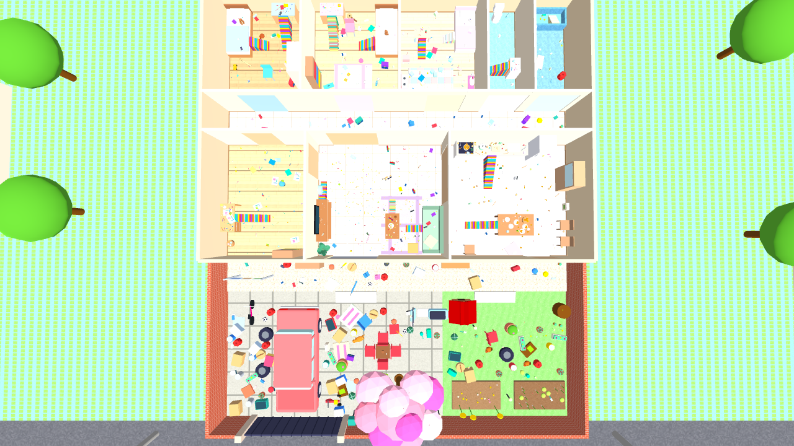
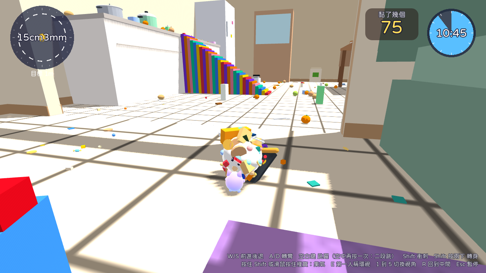
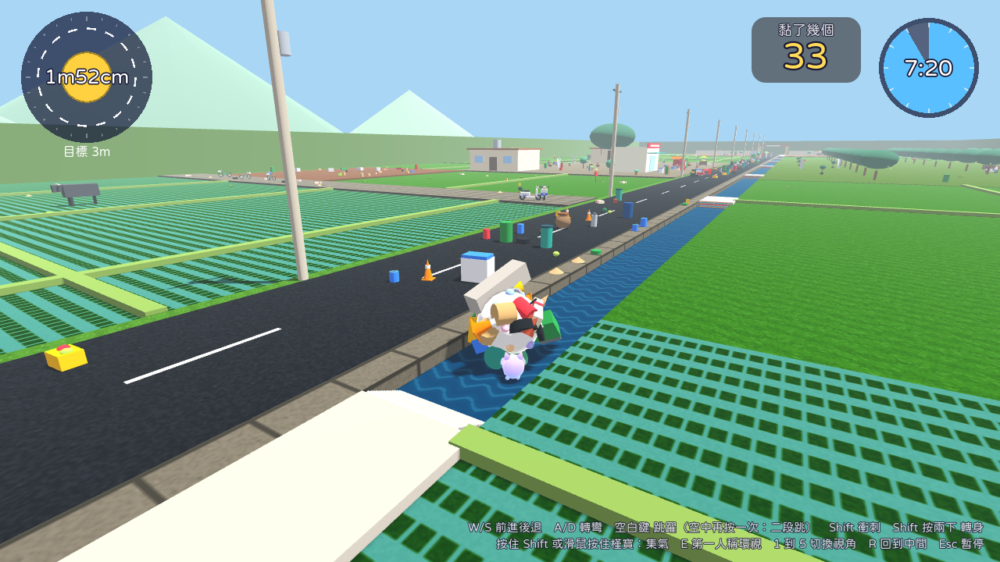
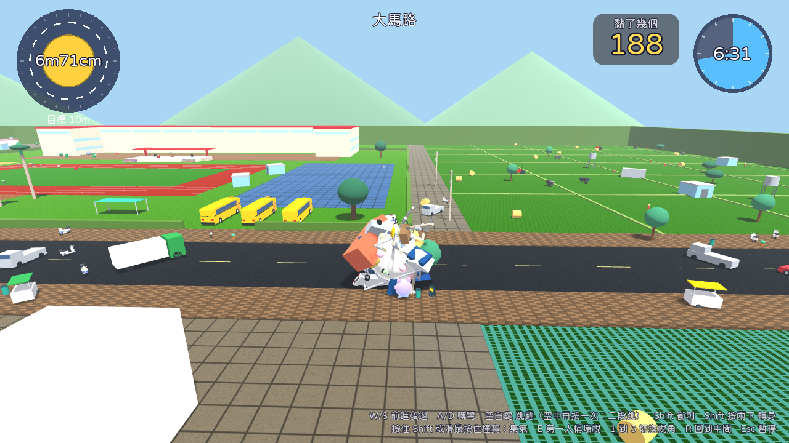
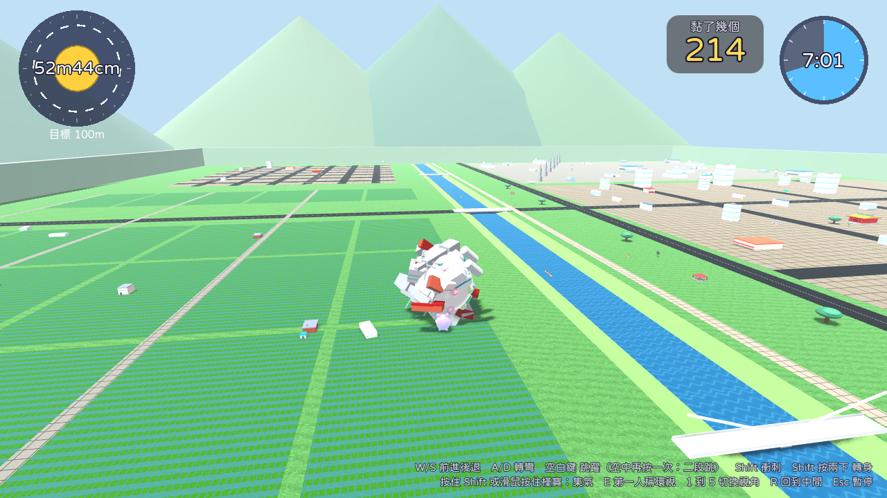
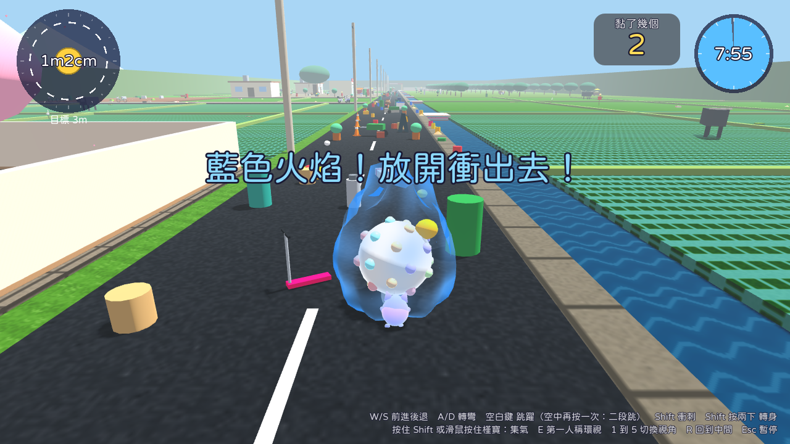
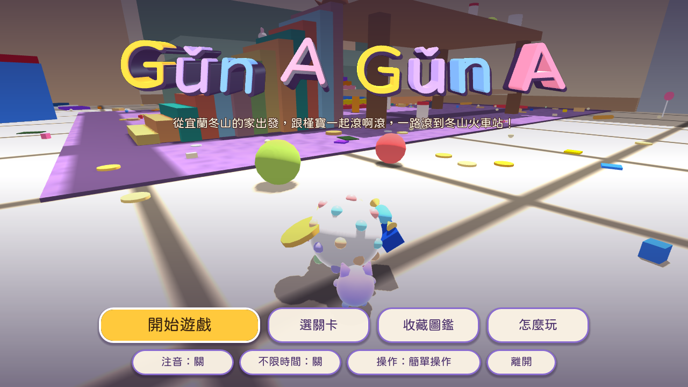

# Gǔn A Gǔn A

英文工作名 Rolling Home。給小學生玩的 3D 滾球收集遊戲，玩法致敬 2004 年 PS2《塊魂》，角色、場景、美術與音樂全部原創。故事從宜蘭冬山鄉開始：槿寶推著白色粉彩滾球，先在家裡把零食、蠟筆、玩具黏起來長到 1 公尺，再沿著上學的路、經過小學，一路滾到冬山火車站，變成 100 公尺的大球。




## 1. 快速開始

不想安裝：直接開啟網頁版 https://claude.ai/artifact/JAZV8uYdapnA5hbhnhLir9 ，按「開始玩」即可（電腦用鍵盤，iPad 與手機用觸控，建議橫著拿）。這個連結預設只有擁有者能開，要給別人玩請用頁面的分享選單。

自己用 Godot 開專案：

1. 下載 Godot 4.7.2 stable（標準版即可，不需要 .NET 版）：https://godotengine.org/download/archive/4.7.2-stable/

2. 開啟 Godot，選「匯入」，指向 `rolling-home/godot/project.godot`。

3. 第一次開啟會自動匯入資源，約 10 到 30 秒。

4. 按 F5（或右上角的播放鍵）開始遊戲。


## 2. 操作

| 動作 | iPad、手機 | 鍵盤 | 手把 |
| --- | --- | --- | --- |
| 前進、後退、轉彎 | 左邊按住拖曳 | W、S、A、D | 左搖桿 |
| 集氣（每 1 秒升一段：黃、橘、紅、藍色火焰），放開衝出去 | 搖桿放開後馬上再按住 | 按住 Shift | 按住 X |
| 衝刺 | 右半邊往上滑 | Shift 按一下 | X 按一下 |
| 轉身 180 度 | 轉身按鈕 | Shift 連按兩下 | Y |
| 跳躍（往前小跳，空中再按一次二段跳） | 跳躍按鈕 | 空白鍵 | A |
| 回到中間（卡住時） | 右側房子按鈕 | R | 暫停選單 |
| 第一人稱環視（WASD 看四周） | 無 | E | LB |
| 切換視角（1 第一人稱、2 近、3 自動、4 遠、5 正面） | 視角按鈕 | 數字 1 到 5 | Back |
| 看遠一點 | 看遠按鈕（按住） | Tab | RB |
| 暫停 | 暫停按鈕 | Esc | Start |

觸控按鈕只有圖示、不寫字。右上角會顯示目前黏了幾個。不高的台階會自動滾上去，家具旁邊有積木樓梯可以爬上去。

標題畫面可以切換「操作」（簡單操作或原作式雙搖桿）、「注音」（介面字旁加注音）、「不限時間」。


## 3. 目前內容

1. 四關：

   - 第 1 關「槿寶的家」：6cm 到 1m。冬山的單層平房，客廳在吃零食、廚房在煮咖哩、書房在畫蠟筆，還有哥哥、姐姐、妹妹的房間，廁所有小昆蟲、浴室有洗澡玩具；門口有圍牆、汽車和會落花的山櫻花，小花園；可以把貓咪和小狗黏起來。
   - 第 2 關「上學的路」：1m 到 3m。水田、鴨池、柑仔店、土地公小廟、文旦園、水圳上的小橋，終點是學校大門。
   - 第 3 關「小學與街區」：3m 到 10m。操場跑道、遊戲場、籃球場、司令台、校車，校外的大馬路、街區與稻田。
   - 第 4 關「滾到冬山火車站」：10m 到 100m。冬山小鎮、稻田、文旦果園與茶園、冬山河與大橋、工業區，最後是瓜棚造型的高架車站。

2. 手感：白色核心加粉彩小圓點的滾球，最後黏的 10 件突出在外圍、滾起來一顛一顛；集氣衝刺至少 3 倍速，撞到比自己大的東西會彈回來掉東西；成長里程碑時槿寶歡呼「Yooo～ GIN Gin～」。

3. 音樂：紅白機風格的原創晶片音樂五首；橘子、咖哩、小昆蟲、鴨子、火車等物件有專屬的可愛聲音。

4. 遊戲畫面（自動遊玩機器人實際執行時的截圖）：

| 第 1 關 槿寶的家 | 第 2 關 上學的路 |
| --- | --- |
|  |  |
| 第 3 關 小學與街區 | 第 4 關 滾到冬山火車站 |
|  |  |
| 集氣：藍色火焰 | 標題畫面 |
|  |  |


## 4. 文件

| 文件 | 內容 |
| --- | --- |
| [01_遊戲設定文件](docs/01_遊戲設定文件.md) | 機制數值、操作、四關、物件、動物、介面、美術、音訊、測試結果、待決事項 |
| [02_原作研究報告](docs/02_原作研究報告.md) | 2004 年原版與重製版的資料整理與來源 |
| [03_技術架構與工具鏈](docs/03_技術架構與工具鏈.md) | 引擎選型、架構、塊球實作、資料驅動、測試、資產管線、匯出 |
| [04_開發路線圖](docs/04_開發路線圖.md) | 已完成的階段、下一步與長期規劃 |
| [05_兒童版場景與物件研究](docs/05_兒童版場景與物件研究.md) | 小學生文具玩具與寵物的尺寸資料與來源（0.2 版） |
| [06_第1關_槿寶的家](docs/06_第1關_槿寶的家.md) | 房間配置、各房間主題、門檻、樓梯、物件分布 |
| [07_第2與3關_上學的路與小學](docs/07_第2與3關_上學的路與小學.md) | 兩關的配置、在地元素的查證與來源 |
| [08_第4關_滾到冬山火車站](docs/08_第4關_滾到冬山火車站.md) | 配置、冬山車站與冬山河的查證與來源 |


## 5. 測試

在 `rolling-home/godot` 資料夾執行（godot 指 Godot 4.7.2 執行檔）：

```
godot --headless res://tests/unit_tests.tscn
godot --headless --fixed-fps 60 res://tests/flow_test.tscn
godot --headless --fixed-fps 60 res://tests/controls_test.tscn
godot --headless --fixed-fps 60 res://tests/touch_test.tscn
godot --headless --fixed-fps 60 res://tests/autoplay_test.tscn -- --stage home --seed 1
godot --headless --fixed-fps 60 res://tests/autoplay_test.tscn -- --stage street --seed 1
godot --headless --fixed-fps 60 res://tests/autoplay_test.tscn -- --stage school --seed 1
godot --headless --fixed-fps 60 res://tests/autoplay_test.tscn -- --stage station --seed 1
```

場景預覽截圖（需要畫面）：`godot --rendering-driver opengl3 res://tests/level_preview.tscn -- --stage home --out 資料夾 --map`


## 6. 資產管線

```
# 用 Blender 重新產生模型（需要 Blender 5.2 或 pip install bpy==5.2.2）；各關的配方在 tools/blender/recipes/
python tools/blender/generate_props.py godot/assets/models/props [名稱 ...]

# 重新產生場景配置檔
python3 tools/levels/build_dongshan_home.py
python3 tools/levels/build_street.py
python3 tools/levels/build_school.py
python3 tools/levels/build_station.py

# 重新合成配樂與全部音效（需要 numpy）；只要音效用 tools/audio/generate_audio.py
python3 tools/audio/generate_music.py

# 重新下載觸控按鈕圖示
python3 tools/ui/fetch_icons.py
```


## 7. 授權與素材來源

1. 字型：justfont「jf open 粉圓」（Huninn）與注音粉圓（Bpmf Huninn），皆為 SIL Open Font License 1.1，授權全文在 `godot/assets/fonts/`。

2. 模型：由 `tools/blender/` 的配方以程式產生，原創。

3. 音效與配樂：由 `tools/audio/` 的腳本以程式合成，原創；風格參考紅白機時代的遊戲配樂，旋律與和聲進行都是原創；學校鐘聲引用西敏寺鐘聲（1793 年，公眾領域）。

4. 觸控按鈕圖示：Tabler Icons（MIT 授權），經 Iconify 圖示集取得，授權聲明在 `godot/assets/ui/icons/ICON-CREDITS.txt`。

5. 主角：依 Terix 提供的紫色貓咪角色圖，在 Blender 以程式建模（pusher 配方）。

6. 場景中的冬山車站、冬山河等是公共地名與地標，只取建築意象；查證來源列在 06 到 08 號文件。物件不使用品牌名稱、真實店名或學校名稱。

7. 「塊魂」「Katamari Damacy」為 Bandai Namco 的商標，本專案與其無關，也未使用其任何素材。


## 8. 存放位置說明

本專案目前放在 `gpt-ai-assistant` 儲存庫的 `rolling-home/` 資料夾（工作分支），與原本的 LINE 機器人程式無關。建議日後移到獨立的儲存庫，方便管理版本與發行。
