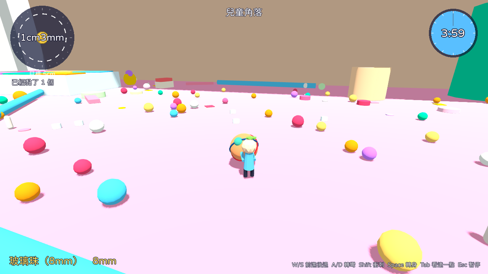
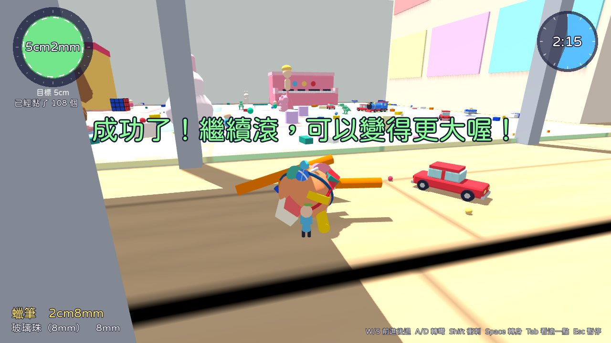
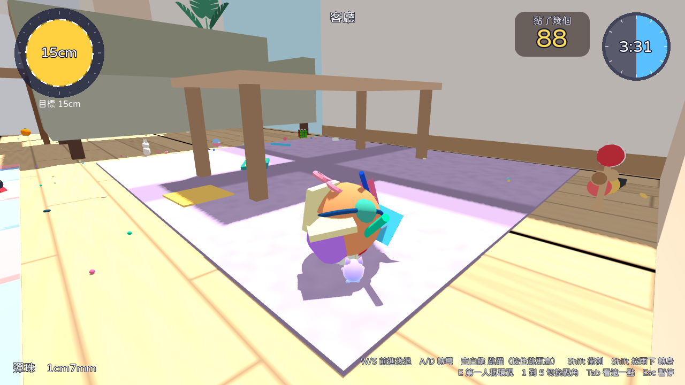
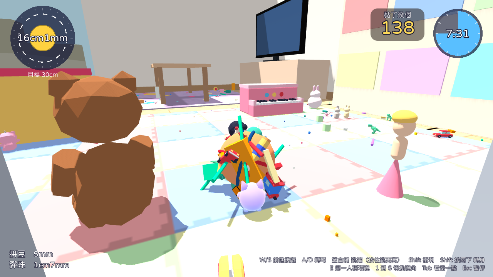
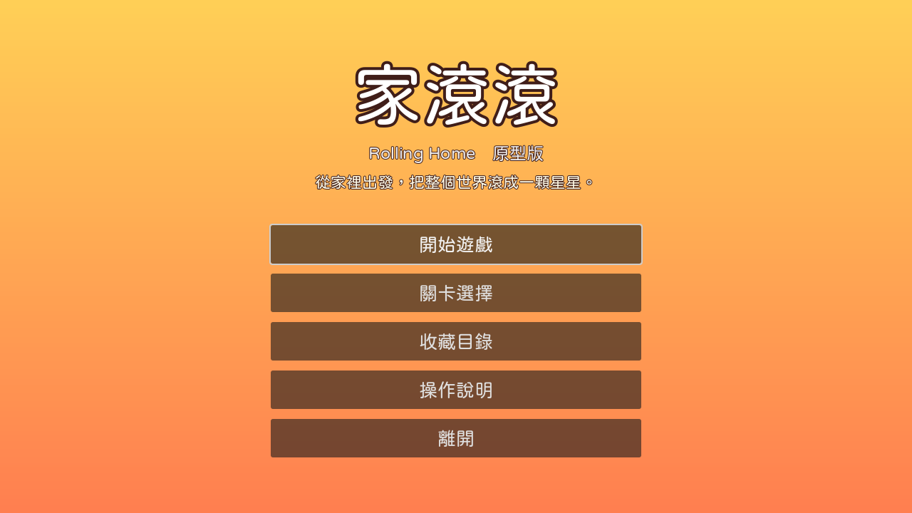
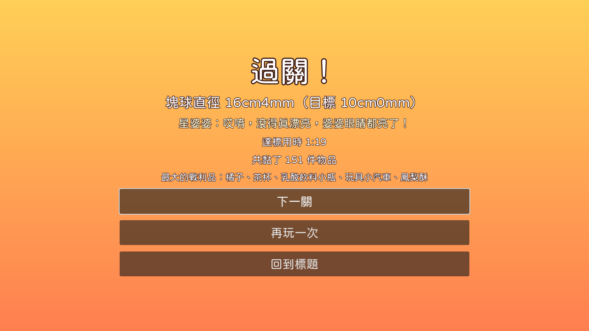
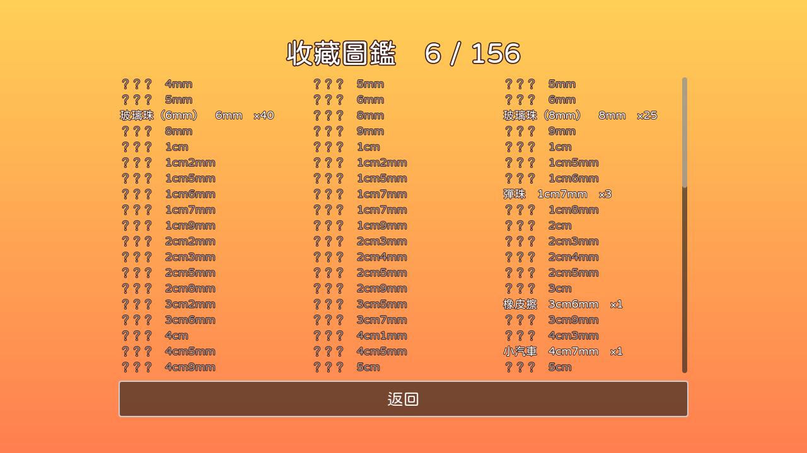
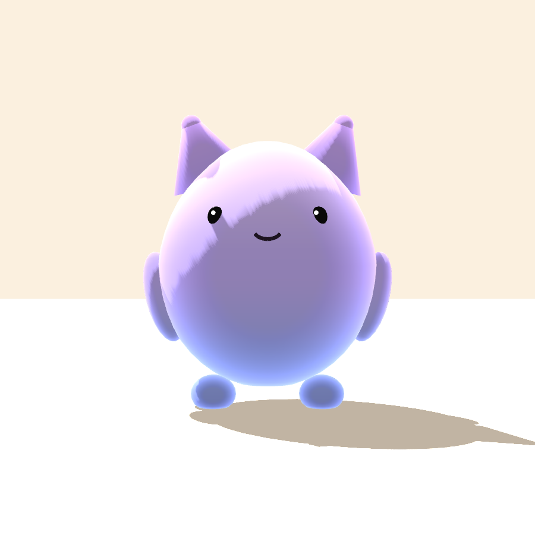

# Gǔn A Gǔn A

英文工作名 Rolling Home。給小學生玩的單機 3D 滾球收集遊戲原型，玩法致敬 2004 年 PS2《塊魂》，角色、場景、美術與音樂全部原創。從姊姊書桌上 6 到 8 公釐的小玻璃珠開始，把積木、橡皮擦、小汽車、恐龍、劍玉通通黏起來，最後連家裡的貓咪都滾進來。




## 1. 快速開始

不想安裝：直接開啟網頁版 https://claude.ai/artifact/JAZV8uYdapnA5hbhnhLir9 ，按「開始玩」即可（第一次下載約 15MB；電腦用鍵盤，手機平板用觸控）。這個連結預設只有擁有者能開，要給別人玩請用頁面的分享選單。

自己用 Godot 開專案：

1. 下載 Godot 4.7.2 stable（標準版即可，不需要 .NET 版）：https://godotengine.org/download/archive/4.7.2-stable/

2. 開啟 Godot，選「匯入」，指向 `rolling-home/godot/project.godot`。

3. 第一次開啟會自動匯入資源，約 10 到 30 秒。

4. 按 F5（或右上角的播放鍵）開始遊戲。


## 2. 操作

| 動作 | 鍵盤（簡單操作，預設） | 手把（簡單操作，預設） |
| --- | --- | --- |
| 前進／後退 | W／S | 左搖桿上下 |
| 轉彎 | A／D | 左搖桿左右，或右搖桿左右 |
| 跳躍（按住跳更高，跑越快跳越遠） | 空白鍵 | A |
| 衝刺 | Shift 按一下 | X 按一下 |
| 集氣（每 1 秒升一段：黃、橘、紅、藍色火焰），放開衝出去 | 按住 Shift，或滑鼠按住槿寶 | 按住 X |
| 轉身 180 度 | Shift 連按兩下 | Y |
| 第一人稱環視（WASD 看四周） | E | LB |
| 切換視角（1 第一人稱、2 近、3 標準、4 遠、5 正面） | 數字 1 到 5 | Back |
| 看遠一點 | Tab | RB |
| 暫停 | Esc | Start |

iPad、手機與平板：左半邊按住拖曳走路和轉彎；按住槿寶集氣，放開衝出去；右半邊往上滑衝刺；右邊有跳躍、轉身、看遠、視角、暫停按鈕。建議橫向。右上角會顯示目前黏了幾個。

標題畫面可以切換「操作」（簡單操作或原作式雙搖桿）、「注音」（介面字旁加注音）、「不限時間」。


## 3. 目前內容

1. 場景：姊弟的家（日式一般家庭一樓）：客廳學習角、客廳、餐廳、廚房、和室、玄關、走廊、洗面所、木平台與小花園。

2. 可玩關卡：

   - 第 1 關「書桌上的小珠珠」：1.2cm 到 5cm，4 分鐘。
   - 第 2 關「客廳大冒險」：3cm 到 15cm，7 分鐘。
   - 第 3 關「全家走透透」：6cm 到 30cm，10 分鐘。

3. 物件 156 種，從 4 公釐的米粒、5 公釐的拼豆、6 到 8 公釐的玻璃珠，到書包、貓咪和柴犬。

4. 三毛貓與柴犬會閒逛；滾球小的時候會拍掉你身上的東西，變大後會逃跑，夠大就能黏起來。

5. 遊戲畫面（自動遊玩機器人實際執行時的截圖）：

| 第 1 關達標（5cm） | 第 2 關客廳（15cm） |
| --- | --- |
|  |  |
| 第 3 關兒童角落（16cm） | 標題畫面 |
|  |  |
| 結算畫面 | 收藏圖鑑 |
|  |  |
| 主角（依 Terix 的角色圖建模） | |
|  | |


## 4. 文件

| 文件 | 內容 |
| --- | --- |
| [01_遊戲設定文件](docs/01_遊戲設定文件.md) | 機制數值、關卡、物件表、介面、美術、音訊、待決事項 |
| [02_原作研究報告](docs/02_原作研究報告.md) | 2004 年原版與重製版的資料整理與來源 |
| [03_技術架構與工具鏈](docs/03_技術架構與工具鏈.md) | 引擎選型、架構、測試、資產管線、匯出 |
| [04_開發路線圖](docs/04_開發路線圖.md) | 下一步與長期規劃 |
| [05_兒童版場景與物件研究](docs/05_兒童版場景與物件研究.md) | 日本一戶建格局、小學生文具玩具與寵物的尺寸資料與來源 |


## 5. 測試

在 `rolling-home/godot` 資料夾執行（godot 指 Godot 4.7.2 執行檔）：

```
godot --headless res://tests/unit_tests.tscn
godot --headless --fixed-fps 60 res://tests/flow_test.tscn
godot --headless --fixed-fps 60 res://tests/autoplay_test.tscn -- --stage home_1 --seed 1
godot --headless --fixed-fps 60 res://tests/autoplay_test.tscn -- --stage home_3 --seed 1
godot --headless --fixed-fps 60 res://tests/touch_test.tscn
godot --headless --fixed-fps 60 res://tests/controls_test.tscn
```


## 6. 資產管線

```
# 用 Blender 重新產生道具模型（需要 Blender 5.2 或 pip install bpy==5.2.2）
blender --background --python tools/blender/generate_props.py

# 重新合成配樂（電子慢速爵士）與啵、叮、啾啾等音效（需要 numpy）
python3 tools/audio/generate_music.py

# 重新合成其他基本音效
python3 tools/audio/generate_audio.py
```


## 7. 授權與素材來源

1. 字型：justfont「jf open 粉圓」（Huninn）與注音粉圓（Bpmf Huninn），皆為 SIL Open Font License 1.1，授權全文在 `godot/assets/fonts/`。

2. 模型：由 `tools/blender/generate_props.py` 以程式產生，原創。

3. 音效與配樂：由 `tools/audio/generate_music.py` 與 `tools/audio/generate_audio.py` 以程式合成，原創暫代音。

4. 主角：依 Terix 提供的紫色貓咪角色圖，在 Blender 以程式建模（`tools/blender/generate_props.py` 的 pusher 配方）。

5. 「塊魂」「Katamari Damacy」為 Bandai Namco 的商標，本專案與其無關，也未使用其任何素材。


## 8. 存放位置說明

本專案目前放在 `gpt-ai-assistant` 儲存庫的 `rolling-home/` 資料夾（工作分支），與原本的 LINE 機器人程式無關。建議日後移到獨立的儲存庫，方便管理版本與發行。
