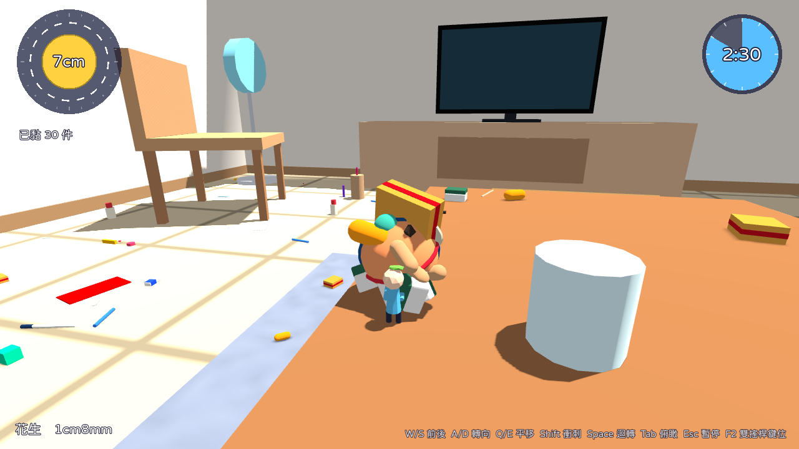

# 家滾滾

英文工作名 Rolling Home。單機 3D 滾球收集遊戲原型，玩法致敬 2004 年 PS2《塊魂》，以原創角色、台灣透天厝場景、原創美術與音樂呈現。推著滾球從阿公阿嬤家的茶几出發，把瓜子、硬幣、藍白拖通通黏起來，越滾越大。




## 1. 快速開始

1. 下載 Godot 4.7.2 stable（標準版即可，不需要 .NET 版）：https://godotengine.org/download/archive/4.7.2-stable/

2. 開啟 Godot，選「匯入」，指向 `rolling-home/godot/project.godot`。

3. 第一次開啟會自動匯入資源，約 10 到 30 秒。

4. 按 F5（或右上角的播放鍵）開始遊戲。


## 2. 操作

| 動作 | 手把 | 鍵盤（預設簡化模式） |
| --- | --- | --- |
| 前進／後退 | 兩支搖桿同推前／後 | W／S |
| 轉向 | 一支前一支後 | A／D |
| 平移 | 兩支搖桿同推左右 | Q／E |
| 衝刺 | 兩支搖桿上下快速交替，或 X | Shift |
| 180 度迴轉 | 同時按下兩支搖桿，或 Y | Space |
| 俯瞰 | RB | Tab |
| 暫停 | Start | Esc |

按 F2 可切換成「鍵盤雙搖桿」模式：左桿 WASD、右桿方向鍵，手感最接近原作。


## 3. 目前內容

1. 可玩關卡：第 1 關「客廳」（5cm 到 10cm，3 分鐘）、第 2 關「一樓與後院」（5cm 到 20cm，6 分鐘）。

2. 物件 63 種，從 1 公分的圖釘到 3 公尺長的流理台。

3. 第 3 到第 10 關的節奏數值已排定，關卡選擇畫面顯示為規劃中。


## 4. 文件

| 文件 | 內容 |
| --- | --- |
| [01_遊戲設定文件](docs/01_遊戲設定文件.md) | 機制數值、關卡、物件表、介面、美術、音訊、待決事項 |
| [02_原作研究報告](docs/02_原作研究報告.md) | 2004 年原版與重製版的資料整理與來源 |
| [03_技術架構與工具鏈](docs/03_技術架構與工具鏈.md) | 引擎選型、架構、測試、資產管線、匯出 |
| [04_開發路線圖](docs/04_開發路線圖.md) | 下一步與長期規劃 |


## 5. 測試

在 `rolling-home/godot` 資料夾執行（godot 指 Godot 4.7.2 執行檔）：

```
godot --headless res://tests/unit_tests.tscn
godot --headless --fixed-fps 60 res://tests/flow_test.tscn
godot --headless --fixed-fps 60 res://tests/autoplay_test.tscn -- --stage home_1 --seed 1
```


## 6. 資產管線

```
# 用 Blender 重新產生道具模型（需要 Blender 5.2 或 pip install bpy==5.2.2）
blender --background --python tools/blender/generate_props.py

# 重新合成暫代音效與配樂
python3 tools/audio/generate_audio.py
```


## 7. 授權與素材來源

1. 字型：justfont「jf open 粉圓」（Huninn），SIL Open Font License 1.1，授權全文在 `godot/assets/fonts/Huninn-OFL.txt`。

2. 模型：由 `tools/blender/generate_props.py` 以程式產生，原創。

3. 音效與配樂：由 `tools/audio/generate_audio.py` 以程式合成，原創暫代音。

4. 「塊魂」「Katamari Damacy」為 Bandai Namco 的商標，本專案與其無關，也未使用其任何素材。


## 8. 存放位置說明

本專案目前放在 `gpt-ai-assistant` 儲存庫的 `rolling-home/` 資料夾（工作分支），與原本的 LINE 機器人程式無關。建議日後移到獨立的儲存庫，方便管理版本與發行。
